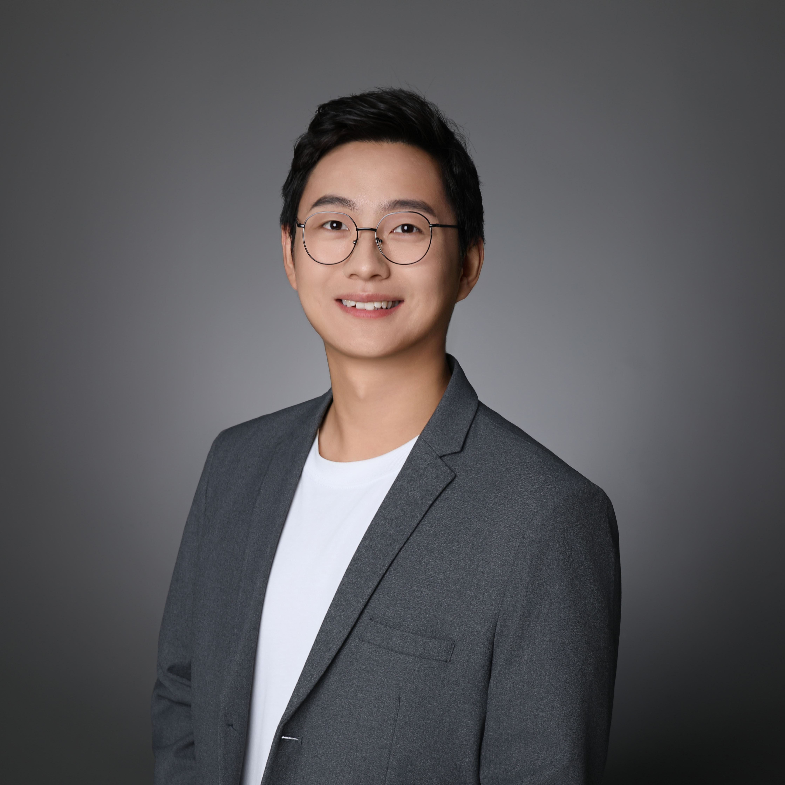

  
感谢您的阅读。我是中国科学技术大学特任副研究员，在<a href="https://ecic.ustc.edu.cn/main.htm" target="_blank" rel="noopener noreferrer">鲍骏研究员</a>课题组开展工作。我关注催化剂在反应时的真实状态，利用原位与工况谱学跟踪催化剂表面结构和化学状态的变化，研究这些变化如何影响反应中间体的形成。

  <h2 class="chinese-text">研究方向</h2>

  
<strong>同步辐射与自由电子激光谱学。</strong>我利用软 X 射线吸收谱（sXAS）和同步辐射光电子能谱（SRPES）研究催化剂的电子结构与表面化学，再用同步辐射真空紫外光电离质谱（SVUV-PIMS）检测气相物种，将表面变化与气相反应联系起来。我也在探索红外自由电子激光在振动和频光谱（SFG）和纳米红外光谱（nano-IR）中的应用，研究催化界面上分子的排列方式及不同位置的化学差异。

  
<strong>从红外到 X 射线的吸收谱学。</strong>我用漫反射傅里叶变换红外光谱（DRIFTS）识别表面反应中间体，用飞秒瞬态吸收光谱（fs-TAS）跟踪光生载流子的动力学过程，并用 X 射线吸收精细结构谱（XAFS）表征催化活性位点的局域结构。

  
<strong>气固催化反应机理。</strong>我研究活性位点的结构、界面电荷转移和反应中间体如何影响反应路径与产物选择性，涉及的反应包括二氧化碳光催化还原、光驱动甲烷氧化偶联（OCM）和丙烷热催化氧化脱氢（ODHP）。

  <h2 class="chinese-text">教育经历</h2>

  <ul>
    <li>2018 年 9 月至 2023 年 6 月，中国科学技术大学，核科学与技术专业，博士。</li>
    <li>2014 年 9 月至 2018 年 6 月，中国地质大学，应用化学专业，学士。</li>
  </ul>

